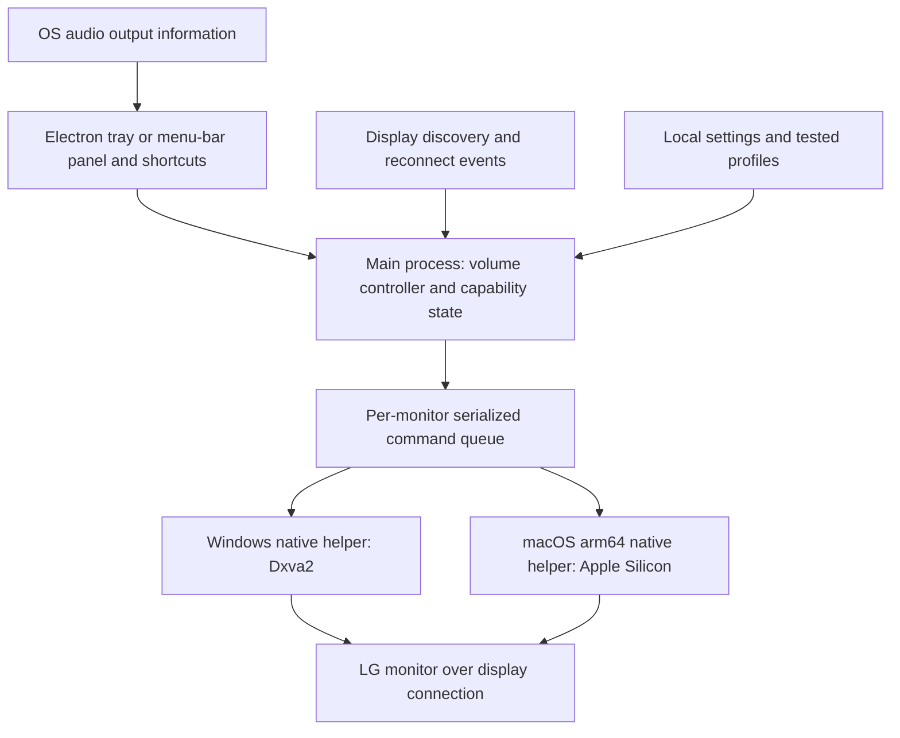

# Monitron — Windows and macOS application plan

Status: implementation in progress. Decisions and validation updated 2026-11-04.

## Decisions and current status

- **Goal:** control the built-in speakers of one LG 49WQ95C-W from Windows and macOS, with convenient switching between the computers if it can be verified.
- **Application:** Monitron uses a shared Electron interface and platform-specific monitor-control helpers. The first macOS target is Apple Silicon: the current M1 and a future M4 or M5 replacement. Intel Mac support is deferred.
- **Current wiring:** an external KCEVE DP+HD dual-monitor KVM serves the single LG monitor. Its remote button is important to the user; keep it until a replacement workflow is proven. The exact KCEVE model and host-to-port mapping remain unconfirmed.
- **Alternative under investigation:** connect Windows and Mac directly to the LG, use its built-in USB KVM, and switch computers through the app, a shortcut, or a compatible desk button. Replace the external KVM only after video, keyboard, mouse, and audio work reliably in both directions. The existing remote button is not assumed reusable.
- **Connection preference:** test the existing KCEVE first. For a direct comparison, use Windows DisplayPort and Mac USB-C when the hardware supports them. Exact compatibility and refresh rates require testing; no cable purchase is assumed.
- **Windows evidence:** DDC speaker-volume read/write and mute/unmute succeeded through the current setup, with the original volume and mute state restored. A Windows directory build and packaged smoke test previously passed. Hardware success is specific to this connection and does not establish Mac or input-switch support.
- **Implementation:** the Electron app, Windows monitor backend, tray and optional volume shortcuts are present. An Apple Silicon volume adapter uses the bundled MIT-licensed m1ddc helper; it has simulated tests but has not been built or tested on the user's Mac. macOS mute, monitor input switching, and KVM switching remain unverified and unavailable.
- **Verification status:** the current automated suite passes 10 tests. The existing Windows package was built previously and must be rebuilt after subsequent source changes before release. Windows audio synchronization code exists and needs explicit behavior and hardware validation before treating it as release-ready.
- **Next:** validate current Windows behavior after the latest changes, build and test the Apple Silicon helper on the M1, then validate bidirectional app-controlled input and USB handoff. Re-run acceptance on the eventual replacement Mac. Keep joystick and KCEVE remote available as recovery paths.

## Recommendation

Build a small tray/menu-bar utility whose first job is to change the LG 49WQ95C-W monitor's actual speaker volume. The chosen architecture is a shared Electron application with platform-specific monitor-control helpers. Keep support claims specific to a tested monitor, OS, computer, and connection.

The user identified the monitor as **LG 49WQ95C-W** and confirmed one physical monitor. Their current Mac uses **M1**, with an intended **M4 or M5 replacement**; the first release targets Apple Silicon only. The current Windows host reports an active `GSM / LG ULTRAWIDE` display through WMI. Windows DDC volume and mute have been tested through the present setup; firmware, exact cable mapping, Mac model/OS and future Mac choice remain unconfirmed. LG's [model page](https://www.lg.com/us/monitors/lg-49wq95c-w-ultrawide-monitor) documents speakers, HDMI, DisplayPort, USB-C, and PBP/PIP/KVM features; its [support page](https://www.lg.com/us/support/product/lg-49WQ95C-W.AUS) lists OnScreen Control for Windows and macOS. These do not constitute a model-specific VCP guarantee. Include PBP/audio-source behavior in testing if used.

## Connection recommendation and KVM requirements

User update: currently uses HDMI and “display” (interpreted provisionally as DisplayPort), with an **external KVM required for its remote switching button**. The user would consider the built-in KVM if the app can provide convenient switching. Their photo identifies the brand as **KCEVE** and the case text as **“DP+HD Dual Monitor KVM Switch.”** An exact model/revision is not readable, so do not assign a 202DH/8202DH model from appearance alone. Host-to-port mapping remains unknown; Mac architecture is confirmed as Apple Silicon (M1 now, planned M4/M5 replacement). Local WMI identifies an NVIDIA GeForce RTX 3060 Ti; verify which GPU actually drives the LG before selecting a GPU-specific backend.

Confirmed topology: **one physical monitor, the LG 49WQ95C-W**. The KCEVE case's dual-monitor capability does not introduce a second-display requirement. Its output-to-LG cable mapping and any PBP use remain unconfirmed. Plan normal full-screen switching between computers by default; validate PBP only if the user uses it. The proposed replacement therefore needs one display-input handoff plus USB keyboard/mouse and audio behavior. Do not interpret HDMI and DisplayPort as a combined bandwidth connection.

The [KCEVE manufacturer catalog](https://kceve.com/products/) covers multiple KVM families. No exact-match primary-source documentation establishing DDC/CI passthrough or a host software-control API was identified from this photo. Treat both as unknown; do not promise app control of the KCEVE itself, keyboard-hotkey support, remote-button reuse, or 5120×1440 refresh support based on other KCEVE models. Keep its physical remote operational during validation.

**Recommendation: test the current wiring first; use direct video as the baseline before buying equipment.** If the current KVM passes volume read/write correctly, retain it. If direct control succeeds but the same operation fails through the KVM, investigate that switch's documented DDC/CI mode or bypass its video path. A working picture or EDID emulation alone does not establish DDC/CI command forwarding. KVM manufacturer documentation can distinguish these features; for example [Adder's AV4PRO-DVI manual](https://cdn11.bigcommerce.com/s-hltjsp5jm3/content/pdfs/MAN-AV4PRO-DVI-Adder.pdf) describes a separately configurable Hybrid DDC feature. This is evidence of the distinction, not a recommendation to buy that older DVI product or a claim about this user's switch.

Proposed direct wiring, subject to host capability:

```text
Windows GPU ── DisplayPort ────────────── LG DisplayPort input
Mac ────────── USB-C video + USB ──────── LG USB-C input

Keyboard/mouse ── LG downstream USB ports
Windows ───────── USB data cable ──────── LG USB-B upstream
Mac USB data is carried by the USB-C connection above.
```

LG documents a built-in KVM and USB-C with up to 90 W power delivery on the [model page](https://www.lg.com/us/monitors/lg-49wq95c-w-ultrawide-monitor). Its [owner's manual](https://www.adorama.com/col/productManuals/LG49WQ95CW.pdf), authored by LG and mirrored by Adorama, documents USB upstream selection and KVM controls. Configure the DisplayPort input to the Windows USB-B upstream and USB-C input to the Mac USB-C upstream where those settings are available. Confirm switching behavior on the unit; do not equate USB switching with successful DDC input switching. Power delivery may not replace the Mac's charger under every workload.

For a Mac with a suitable video-capable USB-C/Thunderbolt port, use a full-featured USB-C cable supporting display video, not a charge-only cable. Direct USB-C-to-DisplayPort is another test option if the LG USB-C input is unavailable; the monitor has only one DisplayPort input, so allocate inputs accordingly. HDMI remains a valid candidate, particularly on Windows; its Mac DDC support depends on the specific hardware/backend. Do not promise a refresh rate until the Mac/GPU, cable, color mode, and full path have been tested at 5120×1440.

Alternative: keep an external switch for keyboard/mouse USB only and connect video directly, if its USB switching can operate independently. This removes that switch from the display-control path but may require separate input switching. Standard DDC travels with the display connection; a separate USB data cable does not automatically repair DDC blocked in a video KVM.

If retaining or replacing a video KVM, require explicit DDC/CI read/write forwarding for the selected host, alongside the required resolution/refresh/audio support. “DDC,” “EDID,” and “EDID emulation” marketing alone are insufficient. Validate behavior after switching away and back; do not assume inactive hosts can control the monitor. The app should discard writes queued before a switch, reacquire the connection, and re-read actual volume when reachable. A generic DDC failure cannot identify a KVM as the cause without a direct-vs-switched comparison.

Acceptance adds: current KVM versus direct connection on the same host/input; HDMI versus DisplayPort where practical; host switch and return; audio follows the intended host; optional monitor-built-in KVM and PBP. Prefer single-input mode for the first control test, then validate PBP's selected audio source separately.

## Switching workflow: retain the external button or validate an app replacement

Convenient switching is now a product requirement. Keep the external KVM as the baseline until the replacement passes hardware acceptance. Speaker control remains the original objective; input/USB switching is a conditional first-release feature, with its own feasibility gate rather than an assumed benefit of DDC volume support.

### Proposed built-in KVM experience

- Run the Electron application on both computers. Each panel has an explicitly named destination: “Switch to Windows” or “Switch to Mac,” plus the same configurable shortcut on both systems.
- Keep video direct (Windows DisplayPort, Mac USB-C if supported) and configure the LG USB upstream assignments once. The current host sends a validated input command to the other host's input; the monitor must then move the USB keyboard/mouse to the target host as verified during setup.
- Do not require the inactive host to send the first command. After switching, the newly active host's app handles the return command through its own now-active connection. This avoids assuming inactive-input DDC access. Still test both directions explicitly.
- Optional physical control: a programmable USB HID button connected through the LG hub can invoke the shortcut on whichever computer currently receives that hub. This is a proposed integration to validate, not a purchase recommendation or a guarantee of pre-login support. The existing external KVM's remote button may be proprietary and cannot be assumed reusable.
- Debounce one press into one transition. Ignore held-key repeat and stale key events around USB reattachment; require release/new press before another switch. Destination buttons use configured inputs rather than a guessed toggle based on cached state.
- Display “Switch requested” before the source loses its video connection. The source cannot infer success solely from disconnection or API success. During setup, require visual confirmation, keyboard/mouse operation, and audio checks on the destination. Do not blindly retry after handing off the connection.
- Keep the monitor joystick or external KVM available as fallback when an app is stopped, the active host is asleep/hung, a login screen is displayed, or USB routing fails. Software shortcuts do not guarantee the independence of a hardware KVM button. No network coordinator is required for the normal two-app handoff.

### Protocol feasibility

Test standard input-select VCP `0x60` with verified per-input values. If it fails, investigate only model-supported alternatives. [BetterDisplay's maintainer guide](https://betterdisplay.pro/guide/faq/general/input-switch-back/) documents an LG alternate transport plus alternate input command and explicitly separates video switching from USB routing. Generic LG example values are not a validated port map for the 49WQ95C-W.

Windows may require a raw-I2C backend for an LG alternate protocol. The [lg-input-switch project](https://github.com/meer-cha/lg-input-switch) demonstrates NVAPI raw I2C on a different LG model, the 45GX950A-B, using NVIDIA hardware. The attached Windows host's RTX 3060 Ti makes this a possible investigation path, not established 49WQ95C-W compatibility. Preserve license constraints if reusing code. Do not substitute commands from that monitor without validating this model's protocol. Mac alternate addressing must likewise be supported by the chosen helper.

LG's [manual](https://www.adorama.com/col/productManuals/LG49WQ95CW.pdf) documents per-video-input USB upstream assignments and a separate KVM action whose availability depends on PBP/PIP mode. Start with normal single-input/full-screen mode and assigned USB upstreams. Do not assume the PBP-specific KVM action is the API required for normal computer handoff. If USB does not follow the input and no validated USB-routing control exists, this setup does not replace the external KVM.

### Replacement acceptance

1. Read and change hardware speaker volume on each intended direct connection.
2. From Windows, switch video to Mac; verify keyboard, mouse, and intended audio output work there.
3. From the Mac, switch back; verify the same on Windows.
4. Repeat at least 20 round trips with the real peripherals, without manual USB correction or unintended double switching. Record measured switch/USB-ready time; use a provisional usability target of at most five seconds on awake hosts, to be revised after measurement.
5. Test the optional physical button on both hosts, app restart, and sleep/wake. Document manual recovery for stopped/hung hosts and pre-login conditions.

If both directions and USB follow fail acceptance, retain the external KVM and focus the application on speaker control through that path. Supporting the existing KVM button or controlling the external KVM itself requires its model and a documented control interface. Do not replace the external switch based on video-only success.

Allow an additional 1–3 engineering days for the switching feasibility investigation. Implementation estimates for input/button integration follow the results; undocumented LG/GPU paths can exceed this allowance.

## Research conclusions

- LG's own [software guide](https://www.lg.com/content/dam/channel/wcms/it/supporto/guide-soluzioni/download/dual-controller-guide-sw.pdf) describes OnScreen Control volume adjustment for supported models. Its [current support guide](https://www.lg.com/us/support/help-library/lg-monitor-how-to-install-onscreen-control-and-use-its-features--20155115803113) documents connection limitations. Try the model-appropriate LG software as an initial baseline; documentation alone does not establish support for this monitor.
- Windows has native [DDC/CI read](https://learn.microsoft.com/en-us/windows/win32/api/lowlevelmonitorconfigurationapi/nf-lowlevelmonitorconfigurationapi-getvcpfeatureandvcpfeaturereply) and [write](https://learn.microsoft.com/en-us/windows/win32/api/lowlevelmonitorconfigurationapi/nf-lowlevelmonitorconfigurationapi-setvcpfeature) APIs in Dxva2. Microsoft explicitly recommends physical validation because implementations differ.
- [MonitorControl](https://github.com/MonitorControl/MonitorControl) demonstrates hardware volume controls and keyboard integration on macOS. [m1ddc](https://github.com/waydabber/m1ddc) provides an Apple Silicon reference, including selected built-in HDMI paths. These are feasibility evidence, not guarantees for this LG model.
- A successful control command does not route sound to the monitor. OS audio output selection and monitor volume are separate concerns.

See [monitor-control-research.md](monitor-control-research.md) for protocol details, platform limitations, and primary sources.

## Scope

### First release

1. Discover connected physical monitors and let the user choose the LG display.
2. Show hardware volume as 0–100%, normalized from the monitor's reported range.
3. Adjust volume with a slider, small step buttons, and configurable shortcuts.
4. Mute/unmute using a verified mute command; optionally emulate mute by setting volume to zero if necessary, clearly identifying this mode.
5. Show connection status and actionable diagnostics.
6. Recover after sleep, unplugging, input changes, and reconnecting.
7. Offer launch-at-login and remember the chosen monitor.
8. Conditionally include app/shortcut switching between computers, with optional USB button, only after video and USB handoff pass the replacement acceptance above.

### Later, separately validated features

- Contrast after individual read/write checks. Brightness (VCP 0x10) passed read/write checks on the 49WQ95C over macOS m1ddc and has shipped.\n- Broader input-switching support beyond the two verified computer connections.
- Optional media-key integration when the monitor is the selected audio output.
- Picture-by-picture audio source, KVM, or proprietary LG settings only after their protocols are established for the exact model.

User-triggered switching is conditional on validation. The intended release does not perform autonomous input switching, startup volume restoration, firmware changes, or factory resets. Current Windows audio synchronization code can set monitor volume at startup; review that behavior against this decision before release. No cloud account or network service is required.

## User experience

One click on the tray/menu-bar icon opens a compact panel:

```text
Monitron
Display: LG ULTRAWIDE                [Change]
Connected · Monitor speaker volume

Volume                                  35%
[-] ───────────●─────────────────────── [+]
[Mute]

Audio output: LG display / Other / Unknown
[Settings]                 [Diagnostics]
```

The volume above is an illustrative UI value, not a measurement from the user's monitor.

- First run: select monitor → inspect support → explain audio routing → test a small volume change → save the verified profile.
- Display identity should include a user alias and enough connection detail to distinguish identical models. Treat EDID serials as optional; they can be absent or duplicated.\n- Slider movement gives immediate pending feedback. Mark the setting confirmed only after readback when available. If only writes work, say “Sent; value not verified.”
- Distinct states: checking, connected, pending, disconnected, control unavailable, command failed, and write-only/unverified. Never leave a stale slider looking connected.
- Diagnostics show monitor identity, backend, tested features, last operation/error, and direct-connection troubleshooting. Export omits monitor serials and personal paths by default.
- Default shortcuts use explicit modifier combinations. Ordinary volume keys continue their existing behavior until the user enables integration.
- Do not change audio output silently. First release can explain how to select the LG audio output; automatic endpoint matching is optional and must allow manual correction.

## Architecture

Chosen direction: one Electron UI and main-process controller with platform-specific monitor-control helpers. The current implementation uses JavaScript, a PowerShell/Win32 Windows helper, and the m1ddc native helper on Apple Silicon. TypeScript, shared protocol fixtures, and a compatibility-profile format remain optional implementation improvements rather than completed features.

| Layer | Windows | macOS |
|---|---|---|
| UI and desktop lifecycle | Electron tray popup; shared TypeScript UI | Electron menu-bar popup; shared TypeScript UI |
| Display discovery | Win32 display enumeration and physical-monitor handles; display-path/EDID identity | CoreGraphics display enumeration plus IOKit identity matching |
| Monitor transport | C# or C++ helper using Dxva2 low-level monitor configuration; investigate NVAPI only if needed for validated LG input switching | arm64 Swift helper with isolated Apple Silicon IOAVService adapter, based on audited implementations; Intel support deferred |
| Audio route information | Core Audio endpoint inspection | Core Audio output-device inspection |
| Persistent data | Local settings and versioned compatibility profiles | Same logical schema in local settings |

Electron shares the interface and application logic but carries a larger runtime than native shells. Fully native UIs remain an alternative if footprint becomes the deciding requirement. Electron provides a [Tray API](https://www.electronjs.org/docs/latest/api/tray); hardware control remains OS-specific. Prefer bundled helper executables over in-process native Node modules to isolate stalled calls and avoid Electron native-module ABI rebuild coupling ([native-module documentation](https://www.electronjs.org/docs/latest/tutorial/using-native-node-modules)). Launch helpers directly with argument arrays, no shell interpolation, and use versioned JSON messages over standard input/output. Keep Node access out of the renderer and expose only a narrow preload IPC interface. Bundle and sign helpers with each application package.

macOS low-level DDC implementations include undocumented/private interfaces. Isolate them, pin audited dependency revisions, preserve license notices, and test every supported OS version. Do not assume Mac App Store acceptance. Initially plan direct signed/notarized macOS distribution and a signed Windows build; validate entitlements and permissions during the spike.



### Backend contract

Keep raw transport operations internal. The UI uses `listMonitors`, `probeVolumeSupport`, `readVolume`, `setVolume`, `readMute`, `setMute`, and `getDiagnostics`. Results distinguish unsupported, disconnected, timeout, permission failure, invalid response, and unverified write.

Each monitor stores an ephemeral connection handle, stable identity hints, backend, connection generation, supported features, raw range, last confirmed values/timestamps, and verification level. Recreate handles after topology changes. Never use an OS enumeration index as permanent identity.

### Control policy

- Read speaker-volume VCP `0x62`; inspect its type and MCCS semantics before normalizing. For a verified continuous range, use the reported maximum rather than assuming 100. Otherwise require a validated model profile; do not normalize reserved command values as ordinary volume levels.
- Probe mute VCP `0x8D` separately. Common encodings are 1 for mute and 2 for unmute, but MCCS versions include additional screen-blank semantics. Validate the advertised values and actual behavior before enabling writes. Volume support does not establish mute support.
- Read capabilities when practical, but distinguish advertised support from successful probes and physical validation. A missing capability advertisement need not prevent a targeted, read-only volume probe.
- Serialize operations per physical monitor; coalesce slider events and keep only the latest target. Start with conservative pacing around 100–150 ms between writes, then measure the hardware. This is a tuning proposal.
- Run transport calls outside the UI thread. Use bounded retries/backoff and a process boundary if a backend cannot cancel stalled driver calls; a UI timeout alone cannot stop a native call.
- Read once on open and after a settled adjustment. Refresh sparingly while visible; avoid continuous high-frequency polling when the panel is closed.
- If mute is emulated with volume zero, restore only the saved pre-mute value from the same active connection/session. Do not persist a stale volume and apply it on reconnect.
- Rescan and re-read after wake/reconnect. Do not replay queued writes from a previous connection generation.
- Control only explicitly selected, supported features. The production UI does not expose arbitrary VCP writes.

## Delivery milestones and exit criteria

### 1. Hardware feasibility: proposed 1–2 engineering days, with both computers available

Record the retail model, firmware if available, Windows GPU/driver, Mac model/chip/OS, cables, dock, and PBP state. Test the actual intended connection, then a direct connection if it fails. Close competing monitor-control utilities during baseline tests.

Build disposable diagnostic probes, beginning with read-only discovery and volume reads. Then make a small reversible volume adjustment at a comfortable level and verify both the monitor's own OSD and audible output. Test mute separately and restore the initial volume afterward. Do not install an alternative audio driver for this test.

**Exit:** verified hardware-volume control on Windows and the intended Mac connection, with a recorded compatibility matrix. If either fails, document whether a changed cable, existing utility, or proprietary transport merits investigation. Stop the full UI build until there is a viable control path. Software volume may be proposed as a separate fallback, never reported as hardware control.

### 2. Backends and resilience: proposed 3–5 engineering days

Implement discovery, identity, queueing, capability state, volume/mute behavior, diagnostics, and reconnect recovery. Validate the macOS API/dependency licensing and distribution approach. Share protocol fixtures and behavior requirements across native implementations.

**Exit:** repeated volume changes work without UI freezes, the target monitor remains correct after reconnection, and unsupported hardware produces a useful error.

### 3. Desktop UI: proposed 3–5 engineering days

Implement compact panels, shortcuts, pending/confirmed states, settings, launch-at-login, and diagnostics export. Add accessible names, keyboard navigation, high-contrast and dark appearance support.

**Exit:** the primary workflow is usable entirely from the keyboard, with no silent audio-route or startup-volume changes.

### 4. Packaging and acceptance: proposed 2–4 engineering days

Test signed builds on the agreed Windows/macOS targets. Exercise sleep/wake, unplug/replug, competing audio output, mute, rapid slider changes, and any dock/PBP configuration the user actually uses.

**Exit:** installable Windows and macOS packages, validated connection matrix, known limitations, and no observed wrong-monitor writes.

Planning estimate: roughly 2–3 engineering weeks for a focused first release after hardware access is available. Private macOS API changes, unsupported HDMI/dock paths, or undocumented LG behavior can increase this substantially. Broader monitor support is a separate project.

## Verification strategy

- Unit tests for range normalization, invalid replies, identity ambiguity, stale connection rejection, coalescing, bounded retry, and mute restoration.
- Backend tests with captured/synthetic transport replies; hardware-in-the-loop checks for actual volume changes. API success alone is insufficient.
- Acceptance matrix: Windows direct connection; intended Mac direct connection; user dock if applicable; sleep/wake; audio output switched away; optional PBP; missing serial; repeated disconnect/reconnect.
- Preliminary responsiveness targets: panel feedback under 100 ms and a settled hardware change under 500 ms on a verified direct path. Treat these as goals to measure in the spike, not guaranteed transport performance.

## Decisions still requiring hardware information

1. Monitor firmware and regional suffix if needed; the model is confirmed as LG 49WQ95C-W.
2. Confirm host-to-port mapping for the reported HDMI/DisplayPort wiring and the external KVM brand/model and settings. Its remote-button workflow must be preserved or replaced with a verified app/shortcut/button workflow.
3. Exact M1 Mac model and macOS version for the test record; exact M4/M5 replacement and OS when selected. Intel support is outside first-release scope.
4. Brightness is now supported (VCP 0x10, range 0–100, verified on macOS). Brightness keys on the Mac keyboard are a possible follow-up. App-controlled computer switching is a desired conditional feature, pending hardware validation.

Execution order: revalidate the latest Windows build, test the M1 path and compare direct video if needed, then prove app-triggered input and USB handoff before considering replacement of the KCEVE. Re-run connection acceptance on the chosen M4/M5 replacement: arm64 support is a design target, not a guarantee that every future port/OS behaves identically. Store device bindings per machine, re-discover the monitor during migration, and copy preferences without copying stale handles or applying cached volume on first launch.
